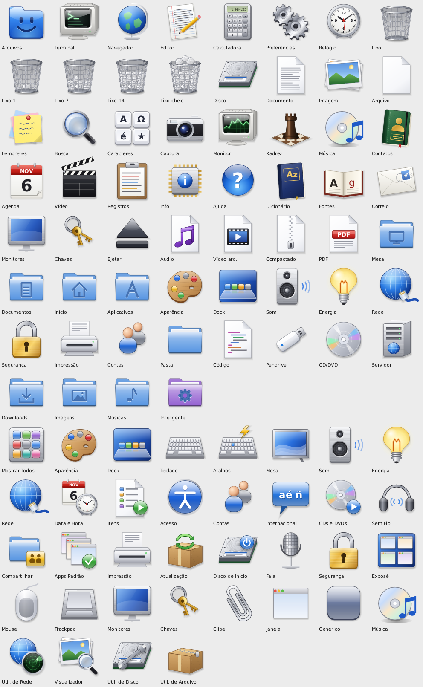

# Glove — tema de ícones

Tema de ícones no padrão freedesktop com a linguagem visual do Mac OS X 10.4 Tiger:
objetos com volume, um pouco de perspectiva, materiais (metal escovado, vidro, gel,
couro, papel), luz de cima e sombra no formato do objeto.

**Toda a arte é própria e desenhada por código** no [Glove](https://github.com/fabioaacarneiro/glove)
(`crates/paint/src/tiger.rs` e `tiger_prefs.rs`). Nenhuma imagem da Apple foi usada,
copiada ou traçada; os ícones do Tiger serviram só de referência de estilo. Não há
marcas registradas (nada de rosto do Finder, bússola do Safari ou logotipo da maçã).



## Conteúdo

- 84 ícones (apps, lugares, aparelhos, tipos de arquivo, preferências, estados), com
  os nomes comuns do freedesktop e do GNOME como atalhos, para os apps de fora também
  usarem os desenhos.
- Tamanhos 16, 22, 24, 32, 48, 64, 96, 128 e 256 pixels, e 2× para telas densas.
- Herda do Adwaita e do hicolor o que não tiver.

## Instalar

```sh
./instalar.sh            # copia para ~/.local/share/icons/Glove
```

Depois escolha **Glove** como tema de ícones (no GNOME: `gsettings set
org.gnome.desktop.interface icon-theme Glove`; no Glove: Preferências › Aparência).

## Gerar de novo

As imagens saem do código do Glove:

```sh
git clone https://github.com/fabioaacarneiro/glove
cd glove && cargo build --release -p glove-arte
./target/release/glove-arte icones /caminho/para/glove-icons/Glove
```

## Licença

GPL-3.0-or-later, a mesma do Glove.
