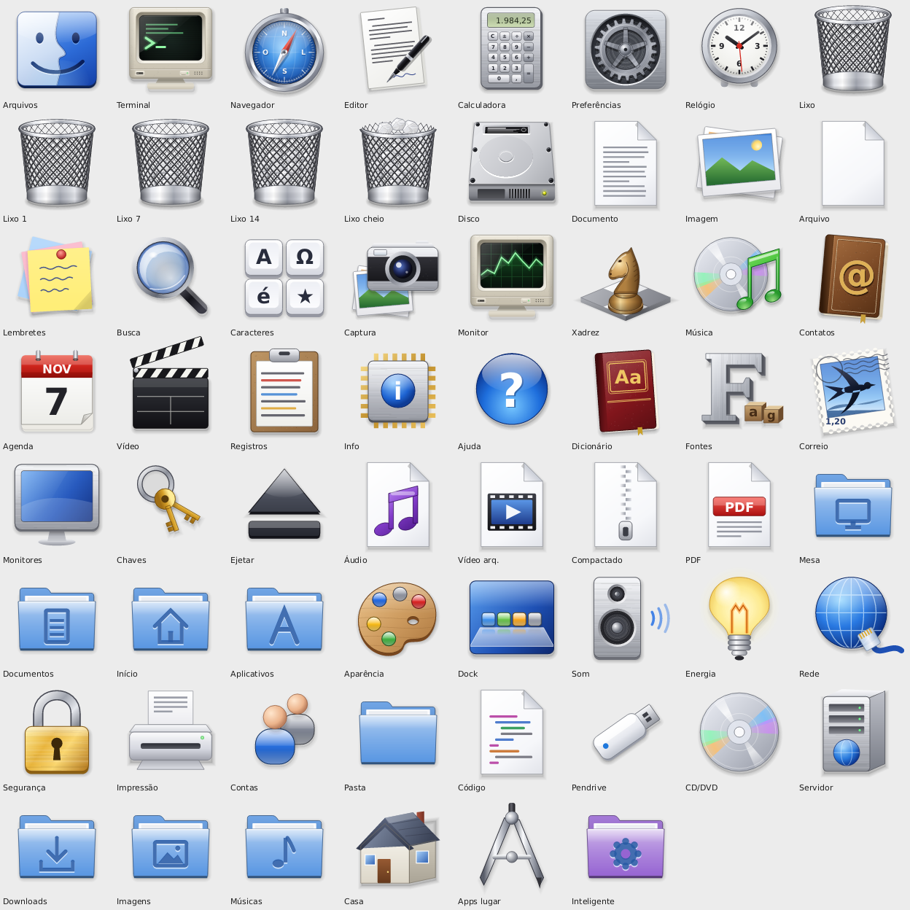

# Glove icon theme

A freedesktop icon theme in the visual language of Mac OS X 10.4 Tiger: objects with
volume, a touch of perspective, real materials (brushed metal, glass, gel, leather,
paper), light from above and shadows shaped like the object.

**All artwork is original and drawn in code** by [Glove](https://github.com/fabioaacarneiro/glove)
(`crates/paint/src/tiger.rs` and `tiger_prefs.rs`). No Apple artwork was used, copied
or traced; Tiger's icons served only as a style reference. There are no trademarks
(no Finder face, no Safari compass, no Apple logo).



## What's inside

- 84 icons (apps, places, devices, file types, preferences, status), with the common
  freedesktop and GNOME names as aliases so other apps pick them up too.
- Sizes 16, 22, 24, 32, 48, 64, 96, 128 and 256 px, plus 2× for HiDPI screens (a 2× size that has
  the same pixels as a 1× one is a link to it, so the theme stays small: about 4 MB).
- Lossless PNGs with maximum compression.
- Anything missing falls back to Adwaita and hicolor.

## Install

```sh
./install.sh             # copies to ~/.local/share/icons/Glove
```

Then pick **Glove** as your icon theme (GNOME: `gsettings set
org.gnome.desktop.interface icon-theme Glove`; Glove: Preferences › Appearance).

## Regenerate

The images are rendered from Glove's source code:

```sh
git clone https://github.com/fabioaacarneiro/glove
cd glove && cargo build --release -p glove-arte
./target/release/glove-arte icones /path/to/glove-icons/Glove
```

## License

GPL-3.0-or-later, same as Glove.
